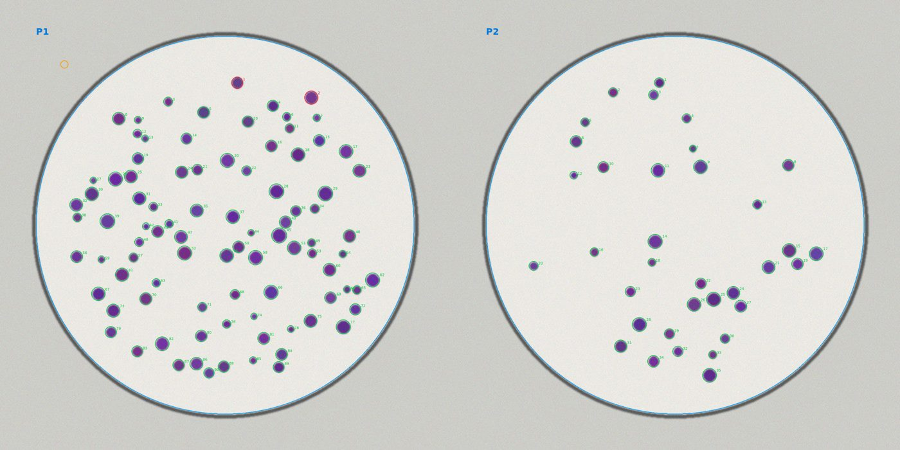
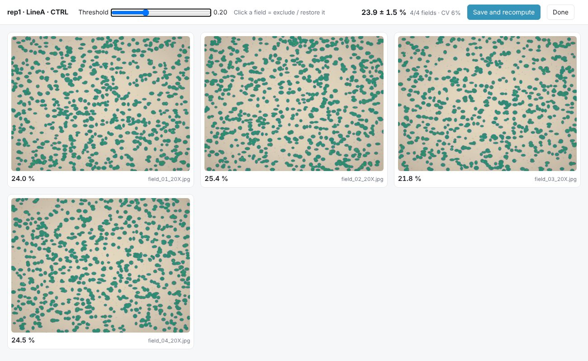

# desks

Free Claude Code skills for wet-lab biologists, built at the bench and used on real experiments.

Every skill keeps a human in the loop: Claude does the tedious part, you check it on a page and correct with a click.

## Install

```
/plugin marketplace add adesantis97/desks
/plugin install bench-assays@desks
```

Python dependencies (once):

```
pip install numpy pandas pillow scipy scikit-image
```

R + tidyverse are needed only if you ask for figures.

## What's inside

- **bench-assays** — quantify bench assays from photos
  - `colony-count` — colony formation assay: counts colonies per dish, mean colony size, fold change vs CTRL
  - `invasion-count` — Transwell invasion/migration: invaded area per field, mean over fields, fold change over biological replicates

More plugins are coming (paper writing, lab organisation).

## How it feels

Drop the photos in a folder and say *"count the colonies"*. Claude writes the plate layout, runs the detection, shows you the overlay and opens a review page:



For Transwell membranes you move one threshold slider and click away the bad fields:



## Try it without your own data

```
python3 plugins/bench-assays/examples/make_examples.py /tmp/desks-demo
```

It draws synthetic plates and membranes with a known ground truth (`truth.csv`), so you can see what the skills get right before trusting them on your experiment.

## Free vs paid

- Everything in this repository is free and MIT-licensed.
- LabsDesk (lab organisation app) and OmicsDesk (omics analysis service) are separate paid products. They are not needed to use these skills.

## License

MIT — see `LICENSE`.
