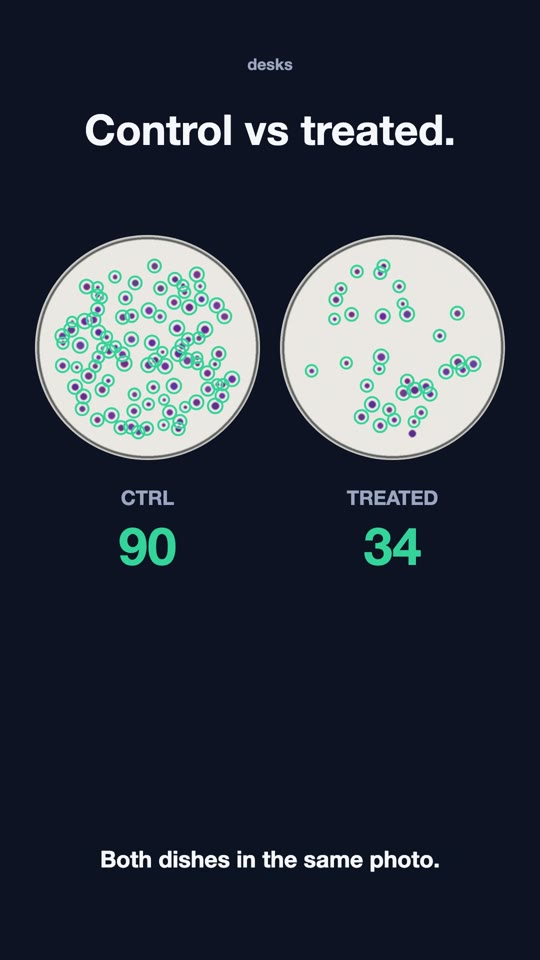
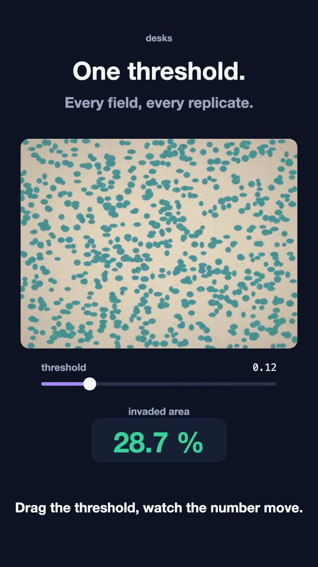

# desks

Free Claude Code skills for wet-lab biologists, built at the bench and used on real experiments.

Every skill keeps a human in the loop: Claude does the tedious part, you check it on a page and correct with a click.

## Install

**Claude Code**

```
/plugin marketplace add adesantis97/desks
/plugin install bench-assays@desks
```

**Cowork** (Claude Desktop app)

1. Customize → Plugins → Add marketplace → `adesantis97/desks`
2. Install **bench-assays**
3. Share the folder with your photos and say *"count the colonies"*

Both need a paid Claude plan (Pro or above).

**Python** 3.10 to 3.13 (once):

```
pip install numpy pandas pillow scipy scikit-image openpyxl
```

In Cowork Claude installs them by itself. R + tidyverse are needed only if you ask for figures.

## What's inside

- **bench-assays** — quantify bench assays from photos
  - `colony-count` — colony formation assay: counts colonies per dish, mean colony size, fold change vs CTRL
  - `invasion-count` — Transwell invasion/migration: invaded cells per field (one dot per cell, click to fix), invaded area beside, fold change over biological replicates, Excel table

More plugins are coming (paper writing, lab organisation).

## How it feels

Drop the photos in a folder and say *"count the colonies"*. Claude runs the detection and opens a review page: you click away the mistakes and get the numbers. For Transwell membranes you set one threshold, check one dot per cell and click away the wrong ones.

<p>
  
  
</p>

## Try it without your own data

```
python3 plugins/bench-assays/examples/make_examples.py /tmp/desks-demo
```

It draws synthetic plates and membranes with a known ground truth (`truth.csv`), so you can see what the skills get right before trusting them on your experiment.

## Free vs paid

- Everything in this repository is free and MIT-licensed.
- LabsDesk (lab organisation app) and OmicsDesk (omics analysis service) are separate paid products. They are not needed to use these skills.

## License

MIT — see `LICENSE`.
